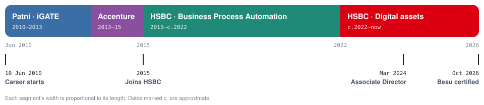

<h1 align="center">Gaurav Bhadange</h1>

  <b>From Java developer to digital-assets architect.</b> 
  Associate Director · Tech SME Specialist @ HSBC · Solution architect for tokenization platforms · Pune, India

  
  
  

Sixteen years in financial and industrial technology: hands-on Java engineering, back-office automation that thousands of operations staff use every day, identity and access design, and now four years architecting tokenization platforms on **DAML / Canton** and **Hyperledger Besu**.

  

<table align="center">
  <tr>
    <td align="center"><h2>16+</h2>years in IT</td>
    <td align="center"><h2>~11</h2>years at HSBC</td>
    <td align="center"><h2>27,000</h2>live users on the ops portal I designed</td>
    <td align="center"><h2>4</h2>years in blockchain &amp; digital assets</td>
  </tr>
</table>

---

## 📖 Four chapters

Each move added a layer: Java foundations, then front-end and enterprise delivery, then architecture and automation at scale, then distributed ledgers.

### 🔷 Digital assets · HSBC &nbsp;<code>c.2022 – now</code>
**Solution architect for tokenization platforms.** Brought into blockchain for my identity and access management expertise, I became the team's solution designer and architect — the person who ties business use cases to technical solutions.

- **Bond tokenization on DAML / Canton** — a modular, bounded-context design covering party registry, instruments, holdings, settlement and lifecycle
- **Multi-asset tokenization & fractionalization on Hyperledger Besu** — wholesale bonds, precious metals and syndicated loans
- **Digital-asset custody** with HSM-backed key management on Google Cloud
- Integration with financial messaging and loan systems: **SWIFT, ISO 20022, Loan IQ**
- Privacy research for Besu: zero-knowledge proofs and Paladin privacy domains
- Promoted to **Associate Director · Tech SME Specialist** in March 2024

`DAML` `Canton` `Hyperledger Besu` `QBFT` `HSM custody` `GCP` `ISO 20022` `SWIFT` `Loan IQ` `Paladin`

### 🟢 Process automation · HSBC &nbsp;<code>2015 – c.2022</code>
**Rebuilding back-office automation for a global bank.** Rather than keep writing bespoke apps, I pushed for a reusable, configurable platform that adapts quickly to new markets and use cases.

- Re-architected an **EJB 2.0 monolith into Spring Boot microservices**, from bare metal to **PCF**
- Acted as business analyst and solution designer on the revamp
- Designed **identity and access management** end to end, integrated with LDAP and Active Directory
- Deep expertise in **BPMN 2.0 with Activiti** — configurable, data-driven workflows
- Event-driven design, message queues, GoF patterns, database tuning, rate limiting and circuit breakers
- 🏆 **27,000 live users** on the daily checklist portal for operations — my idea, a hackathon winner, designed end to end: Angular, Apache, Postgres, Google Cloud
- 🏆 HSBC **Enterprise Engineer Transformation Award**

`Spring Boot` `Microservices` `PCF` `GCP` `Angular` `Express.js` `Postgres` `Oracle` `LDAP / AD` `BPMN 2.0` `Activiti`

### 🟣 Accenture &nbsp;<code>2013 – 2015</code>
**Industrial platforms and portal orchestration.** Built an Integrated Quality Management System (IQMS) for ArcelorMittal's South African steel plant, then managed Volkswagen's orchestration portal spanning 22+ applications. My move into full-stack work.

`Java` `Spring` `JavaScript` `Angular` `React` `Oracle` `MySQL`

### 🔵 Patni Computer Systems / iGATE &nbsp;<code>2010 – 2013</code>
**Learning the craft on a live banking system.** Production support and change delivery for GE's retail banking business — the credit card application and end-to-end card billing system — plus Unix scripting to automate daily operations.

`Java` `Struts` `Servlets` `JSP` `Unix shell`

---

## 🧩 Where each skill came from

| Skill | Patni · iGATE | Accenture | HSBC automation | HSBC digital assets |
|---|:---:|:---:|:---:|:---:|
| Java & Spring engineering | ● | ● | ● | ○ |
| Production support & automation scripting | ● | ○ | ○ | |
| Banking domain | ● | | ● | ● |
| Front end (Angular, React, GWT) | | ● | ● | |
| Microservices & cloud (PCF, GCP) | | | ● | ● |
| Identity & access management | | | ● | ● |
| BPMN 2.0 & workflow | | | ● | ○ |
| Business analysis & solution design | | ○ | ● | ● |
| Distributed ledgers & custody | | | | ● |

● main part of the work &nbsp;·&nbsp; ○ used, but not the focus

---

## ✨ What I bring

- **Business to architecture** — I turn a back-office or capital-markets use case into a working technical design, and have played BA, designer and architect on the same programme.
- **Built, not just drawn** — I've shipped the full stack myself, front end to database to cloud, including a portal used by 27,000 people.
- **A rare combination** — identity and access, HSM custody, workflow automation and two ledger platforms (DAML/Canton and Besu) inside a global bank.

---

## 🛠️ Tech stack

## 🎓 Certifications

- **Linux Foundation — Hyperledger Besu** (Oct 2026, score 91)
- **Google Cloud:** Platform Fundamentals: Core Infrastructure · Essential Cloud Infrastructure: Core Services · Elastic Cloud Infrastructure: Containers and Services · Reliable Cloud Infrastructure: Design and Process
- Complete Python Bootcamp

## 💬 Talk to me about

Tokenized assets & DLT architecture · Digital-asset custody · ISO 20022 & SWIFT integration · BPMN-driven automation · Enterprise architecture

B.E. Information Technology — Government College of Engineering, Amravati

